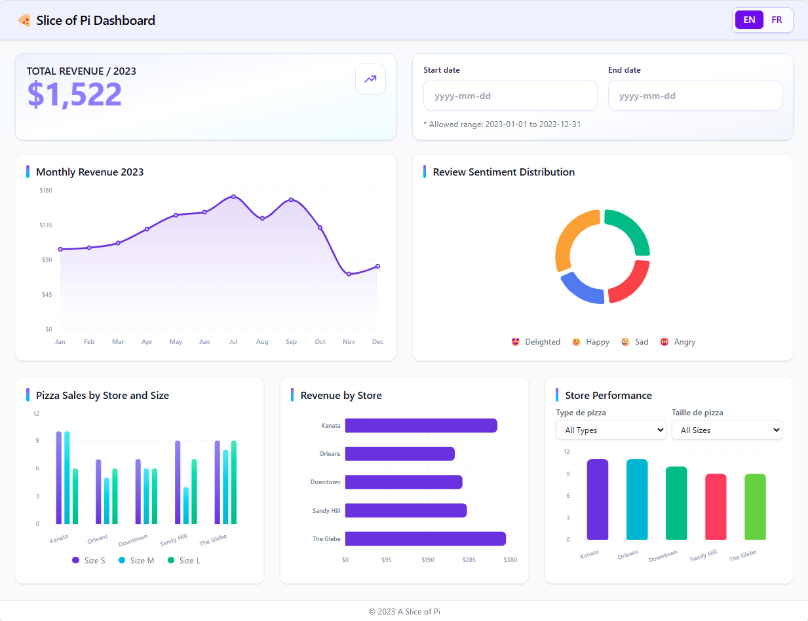
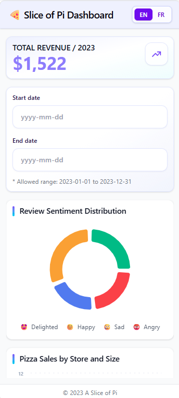

<div align="center">

[English](./README.md) | **Français**

# 🍕 A Slice of Pi

### Un aperçu des ventes de pizzas, des revenus, des restaurants et du sentiment des clients.

Créé avec React, TypeScript, Vite, Tailwind CSS, Recharts et React DatePicker.


[](https://github.com/Hacker0x01/react-datepicker)

</div>

---

## 📸 Captures d’écran

| Ordinateur | Mobile |
| --- | --- |
|  |  |

## ✨ Points forts du tableau de bord

| Visualisation | Description |
| --- | --- |
| **Revenus mensuels** | Évolution mensuelle des revenus, avec une zone légèrement ombrée sous la courbe. |
| **Performance des restaurants** | Nombre de commandes par restaurant, filtrable par type et taille de pizza. |
| **Ventes de pizzas par restaurant et taille** | Comparaison des ventes de petites, moyennes et grandes pizzas dans chaque restaurant. |
| **Revenus par restaurant** | Compare les revenus des restaurants selon le prix configuré pour chaque pizza vendue. |
| **Sentiment des avis** | Répartition du sentiment exprimé dans les avis des clients. |
| **Revenus totaux 2023** | Revenus de toutes les commandes de 2023. |

La plage de dates permet de filtrer les graphiques. Les dates sont limitées à
2023, affichées au format `yyyy-MM-dd`, et les dates de début et de fin sont
incluses. Les filtres de type et de taille de pizza s’appliquent uniquement à
**Performance des restaurants**. La carte des revenus totaux inclut toujours
toutes les commandes de 2023.

> Les pizzas n’ayant pas de date individuelle, le filtrage par date utilise la
> date de la commande qui contient chaque pizza. Les avis sont filtrés selon
> leur propre date.

## 🚀 Démarrage

```bash
pnpm install
pnpm dev
```

Ouvrez l’adresse locale indiquée dans le terminal par Vite.

## 🧰 Commandes

| Commande | Utilité |
| --- | --- |
| `pnpm dev` | Démarre le serveur de développement local. |
| `pnpm build` | Vérifie les types et crée la version de production dans `dist/`. |
| `pnpm preview` | Prévisualise localement la version de production. |
| `pnpm lint` | Exécute ESLint. |
| `pnpm test` | Exécute la suite de tests. |

## 🗂️ Structure du projet

```text
src/
├── common/                 Composants d’interface partagés
├── components/
│   ├── charts/             Graphiques des revenus, des restaurants et des avis
│   ├── filters/            Filtres de dates et de pizzas
│   └── kpi/                Carte récapitulative des revenus
├── constants/              Couleurs des graphiques et tailles de pizza
├── data/                   Données JSON des commandes, avis et prix
├── utils/                  Fonctions de filtrage et de calcul
├── App.tsx                 État et mise en page du tableau de bord
└── index.css               Styles globaux et préférences d’animation
```

Les données du tableau de bord se trouvent dans `src/data/`. Modifiez les
fichiers JSON pour changer les exemples de commandes, d’avis ou de prix des
pizzas.

## ♿ Accessibilité et conception adaptative

- Les sélecteurs de dates ont des libellés associés et des indications de
  format accessibles. Le calendrier prend en charge la navigation au clavier :
  flèches pour changer de date, Entrée pour sélectionner une date et Échap
  pour fermer le calendrier.
- Les commandes de navigation du calendrier ont des noms accessibles en
  anglais et en français.
- La zone des graphiques peut défiler indépendamment des filtres et de la carte
  récapitulative.
- L’animation d’apparition des graphiques respecte la préférence système de
  réduction des animations.
- La mise en page s’adapte aux écrans plus petits.

## 🛠️ Technologies utilisées

React 19 · TypeScript · Vite · Tailwind CSS 4 · Recharts · React DatePicker ·
date-fns
